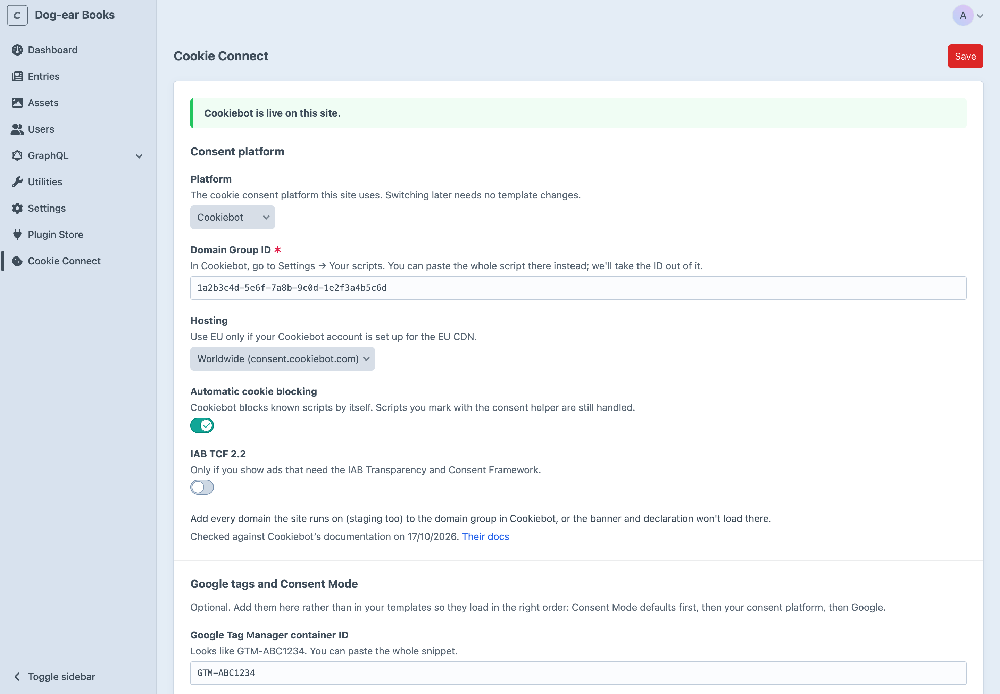

# Installation

## Requirements

- Craft CMS 5.6 or later, PHP 8.2 or later.
- An account with a cookie consent platform: Cookiebot, Usercentrics, OneTrust, CookieYes, iubenda, Termly, CookieFirst, Cookie-Script, or another one through [Custom](platforms.md#custom).

## Installing

```bash
composer require 1994/cookie-connect-craft
php craft plugin/install cookie-connect
```

Or search for Cookie Connect in the Plugin Store.

## Setting it up

1. Open **Cookie Connect** in the control panel. On a multi-site install, pick the site in the breadcrumb menu.
2. Choose your platform and paste its ID, or the whole snippet the platform gives you. Cookie Connect takes the ID out of it and checks it looks right.
3. Optionally, add your Google Tag Manager container or Google Analytics 4 measurement ID (see [Google tags](google.md)).
4. Save. The box at the top says whether the platform is live.



You don't need to change your templates: Cookie Connect puts itself straight after `<head>` on every front-end page.

## Where it runs

The platform only loads in the environments you choose, by `CRAFT_ENVIRONMENT`. The default is `production`, so on your local copy the box says "off in this environment". Change it under **Settings → Plugins → Cookie Connect**, or in [config](configuration.md):

```php
'environments' => ['production', 'staging'],   // or '*' for everywhere
```

Where it doesn't run, content that needs consent stays blocked. To see your tags working on staging without a consent platform, choose **Run it as if accepted** under **Elsewhere**.

Some platforms tie their ID to your domain (Cookiebot's domain group, OneTrust's production script, CookieFirst's site). Add your staging domain in the platform, or use its test ID there; see [Choosing your platform](platforms.md).

## Permissions

Admins can always change Cookie Connect. Give other users **Choose the consent platform and edit Cookie Connect's settings for each site** under Cookie Connect in their permissions. The plugin settings (environments, adding to pages) are in Project Config, so they change where admin changes are allowed.

## Updating

```bash
composer update 1994/cookie-connect-craft
php craft up
```
